<h1 align="left">Hey 👋 What's up?</h1>

###

My name is Huxvie

###

<h2 align="left">About me</h2>

###

✨ Creating bugs since 2019 📚 I'm currently studying Cybersecurity  🎯 Goals: No point in having goals, just live life I guess 🤷‍♂️ 🎲 Fun fact: 85.19% of my repos are private

###

  

###

<picture>
  <source media="(prefers-color-scheme: dark)" srcset="https://raw.githubusercontent.com/huxvie/huxvie/output/pacman-contribution-graph-dark.svg">
  <source media="(prefers-color-scheme: light)" srcset="https://raw.githubusercontent.com/huxvie/huxvie/output/pacman-contribution-graph.svg">
  
</picture>

###

  

###
